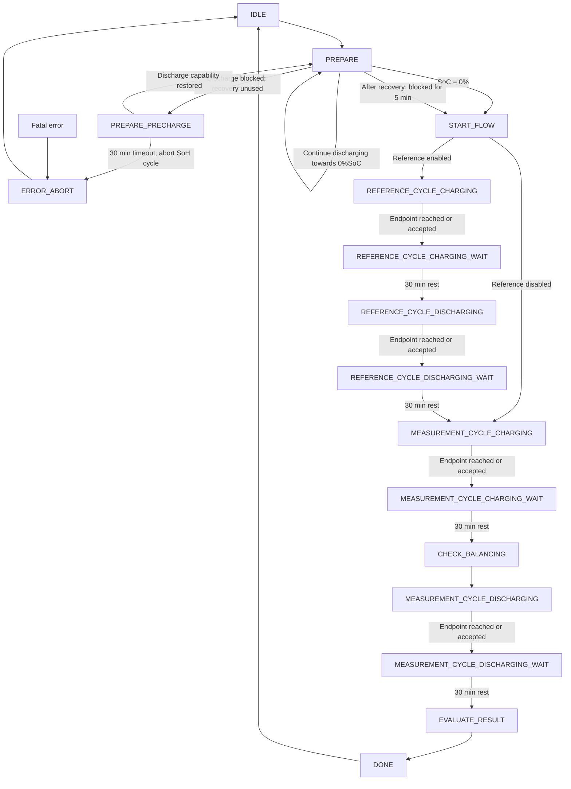
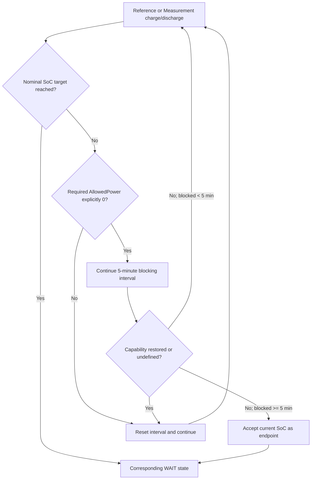

# State Machine

## High-level SoH flow

Each WAIT state provides a 30-minute battery rest with a 0 W battery-power target. DC production is taken into account
when calculating the ESS active-power setpoint. The power ramp is synchronized with the zero battery-power target so
that the next active phase ramps up from zero.

`PREPARE_PRECHARGE` is attempted at most once per SoH run. If discharge capability is restored within 30 minutes,
the controller returns immediately to `PREPARE`. Otherwise, the cycle aborts.

After successful recovery, if discharge remains continuously blocked for five minutes in `PREPARE` before
reaching 0% SoC, the current SoC is accepted as the lower endpoint and the cycle continues.

If discharge capability remains unavailable for 30 minutes, the SoH cycle transitions to `ERROR_ABORT`. Recovery at the
timeout boundary takes priority. Missing required ESS data can also cause `ERROR_ABORT`.

If discharge capability remains unavailable after five minutes, the current SoC is accepted as the lower endpoint and
the cycle continues, provided the required ESS data is valid. Recovery at the timeout boundary takes priority. Missing
required ESS data can still cause `ERROR_ABORT`.

## Shared five-minute endpoint rule

Reference and Measurement charging/discharging phases use the following rule when the nominal SoC endpoint cannot be
reached.

The blocking interval counts only continuously confirmed zero capability.
A nonzero or undefined required `AllowedPower` resets the interval.

When an endpoint is accepted early, the controller requests 0 W battery power for the transition cycle, including
DC-production compensation. The subsequent WAIT state follows the normal rest behavior.

No additional precharge or opposite-direction recovery is attempted during Reference or Measurement phases.

View using Mermaid, e.g. https://mermaid.live/
